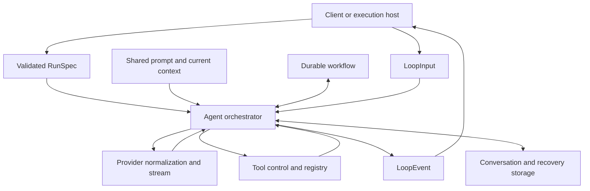

# Agent orchestration

Mitsuro's interactive Agent uses a shared core orchestrator through validated
`RunSpec` contracts. Terminal, web, mobile, and ACP surfaces attach to its
`LoopEvent` output and send `LoopInput` controls. Delegated agents have their own
execution loop; Hive also owns durable Worker admission and commit boundaries.
Shared helpers do not make these execution lifecycles interchangeable.

This document describes the source contracts. A passing test or a local source
change does not establish which binary a deployed service is running.

## Ownership and entry points

A surface resolves the model and its capabilities, builds a `RunSpec` with
`RunSpecBuilder`, and calls `start` with `OrchestratorServices` and conversation
history. The builder validates the run contract before the crate-private
orchestrator starts. Services provide the provider client, tool registry,
process registry, database path, and skills manager.

The run contract includes session and workspace identity, work mode, permission
mode, tool restrictions, provider options, recovery inputs, and an explicit run
budget when configured. Work mode and permission mode are separate: activating
an approved Goal enables Build work without granting additional permissions.

## Conversation, run, attempt, and provider turn

These are different lifetimes:

| Lifetime | Authority |
| --- | --- |
| Conversation | Persisted user, assistant, and tool messages in one session |
| Run | One foreground orchestrator invocation and its terminal event |
| Goal | Durable outcome, approved plan, criteria, and status |
| Attempt | Bounded execution of a Goal step, or verification after the steps |
| Provider turn | One model response and its resulting tool batch |

An ordinary run with an active Goal resolves current workflow state before
provider admission. It claims a dependency-ready attempt when necessary,
refreshes Build context and advertised tools after activation, and seeds its
counters from durable usage. Exhausting a finite attempt can release its step
and admit a replacement; it does not reset the enclosing Goal's token budget
or an explicit caller run ceiling.

Accounting belongs to the Goal and attempt that admitted the work. Completing
a step or starting a successor in one tool batch cannot charge the successor
for earlier work. Replacing a Goal while a provider request is in flight cannot
transfer the old request's effects or usage to the replacement. Terminal
settlement preserves monotonic counters without reopening completed work.

Once required plan work is complete, a bounded attempt without a step can perform
Goal verification. Pending optional steps do not prevent verification of a
completed plan. Goal completion checks the required evidence and settles that
verification attempt atomically. A model's final-looking paragraph does not
complete the durable Goal. A premature final receives one corrective
continuation; a repeated premature final pauses with an actionable incomplete
state. Accepted new user steering renews that correction opportunity.

Hive Worker runs retain their host-owned admission, accepted-input, and outcome
commit contracts. Ordinary Agent attempt helpers do not take over those states.

## One iteration

1. Collect controls and inject accepted steering at a safe model boundary.
   Already-persisted user messages are not persisted a second time.
2. Resolve workflow admission, caller budgets, work mode, and the exact
   advertised tool surface. Durable pause, block, cancellation, and replacement
   are checked again before returned tools can cause effects.
3. Assemble the shared prompt, workspace/project instructions, current workflow,
   and relevant bounded context. Apply shared context-pressure and compaction
   policy before requesting the provider.
4. Normalize streaming text, thinking, tools, usage, and source references.
   Forward ordered events and checkpoint interrupted-response state separately
   from canonical conversation history.
5. Persist the assistant response. Preserve substantive prose accompanying tool
   calls so the next provider request retains the findings the user saw.
6. Execute admitted tools through central capability, permission, approval,
   cancellation, retry, and result-shaping policy. Preserve paired tool results
   when cancellation interrupts a batch.
7. Account progress against the admitted attempt and decide whether to continue,
   await input or a child, pause, or finish. Persist the relevant lifecycle
   transition before reporting it.

Tool output shown to a user and tool output retained for subsequent model
requests have different purposes. `history_policy` creates bounded retained
results while preserving evidence needed to continue. Compaction can summarize
older history; manual `/pinch` and provider-overflow recovery use the shared
in-place path and retain the session identity.

## Prompt and project context

The stable coding contract is shared across providers. Provider-specific wire
formats, reasoning replay, and mutation-tool conventions remain in their
adapters and model profiles. Tool schemas determine the available calls.

System-message text blocks are retained and classified through a shared context
kind. Budget priority and cache stability are deliberately different decisions.
The active Goal receives a bounded view that prioritizes its outcome, execution
obligations, current step, and verification. Explicit excerpt markers direct the
Agent to `workflow_read` for omitted material; a shortened view never narrows the
Goal. Pagination is scoped to the current session and Goal, with content hashes
preventing accidental concatenation across changed sections.

Project instructions are resolved for the actual working directory, including
nested directories. Parent and child execution use the bounded project bundle;
child task content does not silently replace project-instruction authority.

## Delegation and useful progress

Delegation follows the session policy and the available capability.
`ExplicitOnly` requires a user request. Fresh observations across several areas
can trigger one advisory suggestion; breadth alone does not force a productive
audit to stop. Semantic repetition and explicit budgets still constrain runs.

Starting a background child allows the parent to continue independent work.
When further progress depends on that child, the foreground run can finish with
the Goal still active and its attempt paused. The durable child completion wake
owns resumption. `Completed` in that foreground event is therefore not evidence
that the Goal or child is complete. Active-child lookup uses the canonical
parent-wake store rather than a capped recent-history list.

## Stop, steering, and recovery

The input protocol includes approvals, question responses, steering,
already-persisted messages, workflow notifications, and cancellation. The inbox
retains steering while waiting for a control so concurrent user input is not
lost. An in-flight provider or tool lifecycle is not spliced into a second user
message mid-operation.

A disconnected client is not proof that server execution stopped. Ordinary
client Stop detaches its stale stream callbacks, reports cancellation failure,
and reconciles the receipt against authoritative session state. Late results
are fenced by session selection and operation generation. A missing snapshot
cannot establish successful cancellation.

Workflow commands are revisioned and idempotent. A replayed historical receipt
must not interrupt or wake a newer execution state. Operation identity is scoped
to its stored session and action. These durable checks complement live
notifications, which can race with channel registration or removal.

Legacy receipts labelled `goal_paused` or `goal_blocked` do not identify their
original command uniquely. Replaying these receipts returns a conflict; clients
must refresh current workflow state before issuing a fresh command with a new
operation ID. New receipts store the exact command identity.

Recovery checkpoints carry partial text, tool state, and source references.
They remain separate from canonical transcript storage. Approval, unfinished
tool effects, and ordinary attempt settlement must survive retry without
inventing successful work.

## Text and source references

Text annotations are optional fields on canonical text content, so older plain
text records remain readable. Ordinary Agent streaming, interrupted recovery,
storage, and supported clients preserve normalized source references. Empty-text
annotation events can add sources without duplicating prose. Source metadata in
subsequent provider requests is bounded plain reference text; it is not forged
provider-native citation or reasoning replay data.

Display, copy/export, and reload derive text from ordered message parts. A short
preview field does not limit copied final answers. Historical thinking rendering
uses the retained excerpt while canonical content remains available to its
storage lifecycle.

The protocol has turn and run boundaries; it does not provide a universal
semantic progress-versus-final classification for every prose fragment. Clients
must not infer workflow completion from prose. Hive Worker response commits
also retain their separate content and acceptance contract; normalized source
annotations are not a claim of complete provider-feature parity there.

## Validation and source map

Deterministic runtime tests drive local scripted HTTP providers through the
production orchestrator, real tool registry, workflow store, and event stream.
They cover activation, cancellation/resume, attempt rollover, accepted steering,
background parent work, verification, and in-flight workflow changes. Focused
client tests cover Stop races, text retention, and citation recovery.

Ignored benchmarks measure fixed request histories and TUI event bursts. The
opt-in `agent_live_acceptance` integration test uses an explicitly selected real
provider, an exact candidate artifact, and isolated fixture state. It is skipped
by ordinary tests. Scripted tests, this live fixture, native Release interaction
checks, and deployment verification establish different evidence levels.

| Source | Responsibility |
| --- | --- |
| `agent/run_spec.rs` | Validated execution contracts and entry point |
| `agent/orchestrator.rs` | Ordinary provider/tool loop and terminal decisions |
| `agent/orchestrator/workflow_runtime.rs` | Goal admission, accounting, and attempt settlement |
| `workflow/manager.rs` | Revisioned durable transitions and evidence checks |
| `agent/loop_events.rs` | Canonical events, inputs, and inbox |
| `agent/context/` and `ai/model_profile/` | Context assembly and shared prompt classification |
| `agent/stream.rs` and `ai/parsers/` | Stream accumulation and provider normalization |
| `agent/executor/` and `agent/tool_control.rs` | Tool execution and centralized policy |
| `agent/history_policy/` and `agent/compaction/` | Retention, budgeting, and in-place compaction |
| `storage/recovery.rs` | Interrupted-response state |

Paths in the table are relative to `crates/mitsuro-core/src/`.
